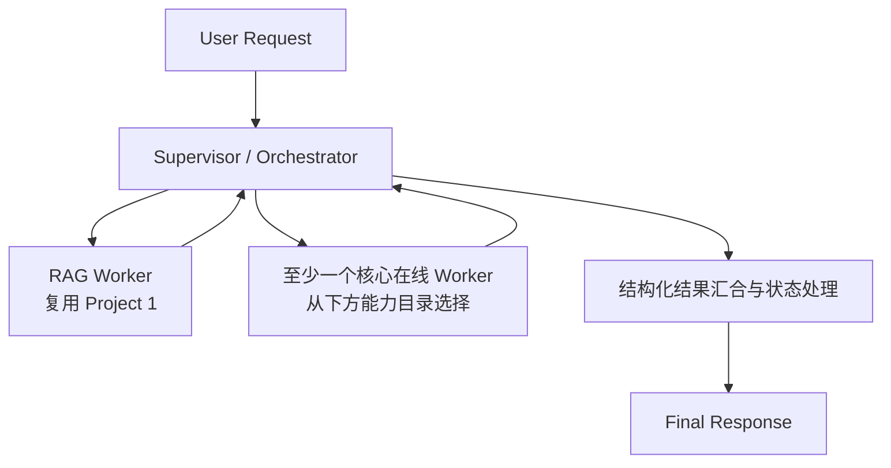

# Chap12 作业评审材料包（Project 2：Supervisor–Worker）

> 给评审者：本文分三部分。第 1 部分是作业原文（未改动）；第 2 部分是实现概要和全部评测数字；第 3 部分是作者自己承认的短板。
> 请依据第 1 部分的“验收标准”和“提交物”逐条判断第 2 部分的证据是否足够，并重点核查第 3 部分列出的问题是否属实、严重程度如何，以及是否还有遗漏。
> 所有数字都来自真实运行记录，没有估算值。凡是没有运行过的项目，都明确标为“未执行”。

---

## 第 1 部分：完整作业要求（原文）

### 作业目标

在连续课程 Project 2 中，基于第 11 章完成的 Project 1 RAG Agent，建立一个中心化的 Supervisor–Worker 协作骨架。Supervisor / Orchestrator 将用户目标路由至复用的 RAG Worker 和至少一个有明确职责的在线 Worker，收集结构化结果、处理失败与部分完成，并给出有证据边界的响应。

本作业会给出拓扑、Worker 能力目录、Contract 要求和验收标准，但不指定每种 Worker 的完整内部实现。学生需根据项目现有数据、服务和模型选择实现方式，并说明取舍；不要求为了增加 Agent 数量把确定性程序包装成 Agent。

本作业定义 Project 2 的第一个 Multi-Agent 增量，不要求构建开放式自治平台或多个互相自由通信的 Agent。第 12 章 Lab 用 Fake Worker 教授 StateGraph 结构；项目实现应复用仓库中的真实 RAG 能力和合法的数据服务。

### 前置条件

- 使用同一课程 Project 仓库、现有接口和 Git / PR 流程；不新建彼此无关的 Toy Project。
- 已有可调用的 Project 1 RAG Agent / Retriever 与其结构化 Evidence；项目中至少有一项适合查询或分析的数据能力。若依赖尚未完成，先在 Spec 中标明范围并补齐前置能力。
- 阅读项目 Constitution / Rules、README、相关模块、测试和前序 HW；在 Feature Branch 上开展工作。
- 用 Spec Kit 按阶段生成并审阅 Specification、Plan 和 Tasks，再逐项实现；命令名称以当前 Project 的 Spec Kit 版本为准。

### 任务步骤

#### 1. 建立基线并定义 Multi-Agent Feature

1. 选择固定、可重复的输入样例，例如“分析 Product A 第二季度销售下降，并结合已授权的企业资料说明可能因素”。
2. 记录现有单 Agent / 固定 Workflow 对该类任务的行为、已支持的工具、数据来源、延迟和限制，作为比较基线。
3. 在 Spec 中明确 Supervisor、RAG Worker 和所选在线 Worker 的职责、输入输出 Contract、授权范围、失败与部分完成行为、Non-Goals 和可验证 Acceptance Criteria。
4. 经人工审阅后再生成 Plan 与 Tasks；画出任务依赖，说明是否存在真实并行机会，不预先假定一定需要并行。

#### 2. 采用固定的 Supervisor–Worker 骨架

本作业要求采用中心化的 Supervisor / Orchestrator 拓扑：

- RAG Worker 必须复用 Project 1 的能力，返回可追溯的 Evidence / Citation、状态和限制；不得在本作业中重做整套 RAG。
- 至少实现一个核心在线 Worker，从“Database Query Worker”、“Analytics / Forecast Worker”或“Domain / API Worker”中选择。可按项目真实需要实现多个，但不要求仅为达到 Agent 数量而拆分。
- Supervisor 将用户目标映射到有限、已注册的任务和 Worker；负责输入校验、授权检查、预算、结果汇合、部分失败状态和最终响应。模型可以参与语义规划，但不能直接决定任意可执行节点、工具或权限。
- Worker 之间通过显式、可验证的 Contract 交换必要数据，不共享无界的完整聊天历史。

#### 3. 从 Worker 能力目录选择并定义 Contract

每种 Worker 的内部实现由学生依据项目决定；Specification 必须说明选型依据，并定义适用于该能力的输入、输出、权限、失败语义和验收场景。至少选择一个核心在线 Worker（3.1–3.3）；可再选择扩展 Worker（3.4–3.6）。能力类型用于帮助界定职责，并不意味着每项能力都必须由 LLM 推理实现。

##### 3.1 Database Query Worker（在线）

**职责：** 对用户有权访问的结构化业务数据执行查询，回答指定数据问题或提供供后续分析使用的结果。可使用受限查询模板、参数化查询、Text-to-SQL 或项目中已有的数据服务；本作业不强制采用 Text-to-SQL。

**Contract 至少应说明：**

- 输入：任务目标、经过授权的数据范围、必要的时间区间及查询约束；
- 输出：查询结果或聚合值、字段 / 指标口径、时间范围、数据来源标识、限制和明确状态；
- 状态至少区分 `completed`、`partial`、`no_data`、`permission_denied` 与 `failed`，并说明哪些状态允许 Supervisor 继续。

若实现 Text-to-SQL，必须由应用程序或数据层落实只读访问、Schema / 表白名单、租户和行级权限、SQL 解析或等价校验、参数化、查询超时与结果规模上限。模型生成的 SQL 不得未经验证直接执行；LLM 不得自行授予访问权限。

##### 3.2 Analytics / Forecast Worker（在线）

**职责：** 调用已登记的统计、分析或预测模型，对符合定义的数据输入执行分析；例如预测指定产品未来数周需求，或对选定业务指标作趋势分析。它负责模型接入与结果 Contract，不应把任意代码执行交给 LLM。

**Contract 至少应说明：**

- 输入：已校验的数据或指标、目标变量、粒度、时间范围 / 预测 Horizon，以及模型所需参数；
- 输出：分析结果或预测值、单位与时间粒度、所用模型标识 / 版本、适用范围、必要的不确定性信息、假设与限制，以及明确状态；
- 若所需数据由 Database Query Worker 提供，写清依赖关系、失败时是否停止以及是否允许使用部分结果。

模型选择和调用应通过程序中的登记表、服务接口或其他受控机制完成。若只调用确定性统计程序或既有模型服务，也可以将它实现为受控 Worker 能力；不要为了“Agent”标签让 LLM 虚构数值或生成、执行任意 Python 代码。

##### 3.3 Domain / API Worker（在线）

**职责：** 调用项目确实需要的、已授权的领域服务或外部 / 内部 API，为 RAG 和结构化数据库查询不能直接提供的信息补充结果。例如物流状态、库存可用性、汇率或工单状态查询。不得仅为展示 API 调用而添加没有项目需求的 Worker。

**Contract 至少应说明：**

- 输入：业务对象标识、请求参数、授权范围和必要的时间 / 地域条件；
- 输出：结果值、单位或状态、来源服务 / 数据时间、适用范围和限制；
- 对 `completed`、`no_data`、`permission_denied`、`timeout`、`failed` 等状态的区分，以及 Supervisor 是否可在部分信息缺失时继续。

凭证应由服务端安全管理；调用目标、操作和参数要经过白名单及校验。明确 Timeout、调用预算、重试 / 幂等行为和速率限制。若 API 会产生副作用（例如创建工单或更改订单），须限定为本作业范围内的明确操作，并通过应用程序执行授权和必要的确认；不能让模型任意构造请求或操作目标。

##### 3.4 Metadata Enrichment Worker（Dataset onboarding，可选）

**职责：** 在数据集接入 / 索引构建前，根据 Schema、文档说明和获准的样本提出 metadata 建议，例如字段描述、实体标签、时间范围或业务分类。它属于 onboarding / ingestion 预处理能力，不一定是在线 Supervisor–Worker 请求链路的一部分。

若选择实现，Contract 至少应说明输入数据范围、建议字段及其证据 / 来源、校验状态和待人工确认项。未经校验或审核的建议不得直接覆盖权威 metadata；不得修改租户隔离、ACL、权限标签或其他安全字段。要说明处理失败、低质量建议、重跑和人工审核如何影响入库流程。若它只运行在 ingestion pipeline 中，不计作本作业要求的在线 Worker。

##### 3.5 Evidence Reviewer Worker（在线，可选扩展）

**职责：** 独立检查最终回答中的关键主张是否能由本次实际提供的 Evidence 支持，指出缺少引用、来源冲突、过度确定的因果陈述或未说明的限制。它提供审查意见，不是事实裁判，也不能替代程序化 Citation 校验。

**Contract 至少应说明：**

- 输入：待审查回答、Claim 到 Evidence 的映射、原始来源定位及审查标准；
- 输出：通过 / 需修改 / 无法判断状态、问题 Claim、对应 Evidence 或缺证说明及可执行反馈；
- 不能仅因引用存在就判定主张受支持；无法核实、来源冲突和审查器失败须有明确状态。

要用正反例测试 Reviewer，包括“有引用但不支持主张”和“证据支持但措辞过强”等情况。若它只重复 RAG Worker 的检索或只做固定格式检查，应保留为普通程序步骤而非独立 Agent；Reviewer 不能替代 3.1–3.3 中至少一个核心在线 Worker。

##### 3.6 项目专属 Worker（可选扩展）

可以提出目录外的 Worker，例如专门处理某一业务领域的分析能力，但需证明其职责、数据或工具权限和验收方式与现有 Worker 有实质区别。可预测的格式化、解析、权限检查或数值运算应优先保留为普通程序，不因模块命名而自动算作 Agent。

#### 4. 实现 Orchestration、权限边界与失败处理

- 定义 State 中的用户目标、任务 ID / 计划、各 Worker 结果、错误 / 部分完成状态、审查反馈和最终响应；说明关键字段由哪个节点写入和读取。
- 对相互独立且无数据依赖的任务，才可选择并行；否则按依赖顺序执行。并行时说明汇合规则、单 Worker 失败和超时行为。
- Worker 只接收完成职责所需的 Context；RAG Evidence、查询结果和模型输出都应保留来源及适用限制。
- `failed`、`partial`、`no_data`、权限拒绝和超时不可伪装成空成功结果。定义必要 Worker 失败时的停止、降级或带限制继续策略。
- 若加入 Critic / Reflection，定义审查条件、结构化反馈、最大 Retry 次数及达到上限后的显式状态。
- 区分 Retry 与 Replan：Retry 修正已有信息上的结果；Replan 改变任务计划或补充信息。Replan 的目标必须来自有限注册表，并通过权限与预算校验。
- 提供程序强制执行的终止条件及总调用、时间或成本预算；不得依赖 Prompt 实现安全、授权或终止。

#### 5. 测试并与单 Agent / 固定 Workflow 比较

至少覆盖：

- 请求被分解并路由至预期的已注册 Worker；未知任务不能调用未注册能力；
- Worker 输入输出 Contract、状态和 RAG Evidence / Citation 的传递；
- 正常完成、无数据、部分完成、权限拒绝、超时和 Worker 失败；
- 若选择 Database Query Worker：越权范围、非法 / 未允许查询和结果规模限制；
- 若选择 Analytics / Forecast Worker：模型选择白名单、输入边界、结果口径与模型失败；
- 若选择 Domain / API Worker：未授权请求、超时、速率或预算边界，以及有副作用操作的确认 / 幂等路径；
- 若选择 Evidence Reviewer Worker：引用存在但不支持主张、来源冲突、过度因果表述和 Reviewer 自身失败；
- Critical Claim 的 Evidence 检查及必要的拒答 / 限制说明；
- Critic Retry 与最大次数终止；如实现 Replan，再测任务白名单和预算；
- 并行分支（若实现）无共享 State 写冲突，单 Worker 失败有明确结果；
- 若实现 Metadata Enrichment：建议字段的证据、校验 / 审核路径、幂等重跑及安全字段不可被更改。

在固定任务集上比较单 Agent / 既有 Workflow 与 Multi-Agent 版本的任务完成度、Evidence / 数据结果质量、延迟、模型调用 / Token 或模型服务成本和失败率。按任务类型说明收益与退化，不假设 Multi-Agent 必然更好；Fake Lab 数据不属于项目评测证据。

### 提交物

- 经审阅的 Feature Spec、Plan、Tasks 及必要的任务 / Contract 变更记录；
- Project 2 中可运行的 Supervisor / Orchestrator、复用的 RAG Worker 和至少一个所选在线 Worker；
- Worker Contract / State 字段说明、所选能力及架构取舍说明和架构图；
- 覆盖正常、部分失败、权限边界、Evidence 和终止路径的自动化测试；
- 单 Agent / Workflow 与 Multi-Agent 的固定样例比较记录，含质量、Evidence / 数据结果、延迟、调用成本和已知限制；
- 若实现 Metadata Enrichment 或可选扩展 Worker，提供对应的输入输出 Contract、失败路径与验收证据；
- Feature Branch Pull Request，列出运行过的命令及实际结果；经 Review 后再合并到 `main`。

### 验收标准

- 系统采用可观察、可测试的 Supervisor–Worker 控制流；Supervisor 只调用已注册且经过权限约束的 Worker。
- 复用 Project 1 RAG Worker，并实现至少一个 Database Query、Analytics / Forecast 或 Domain / API 核心在线 Worker；不要求强制新增第三个 Worker。
- 所选 Worker 的职责、输入 / 输出、数据来源、权限、状态和错误边界清楚，能够独立验证；其内部实现是学生基于项目选择并解释的。
- State 传递结构化必要数据而非无界共享全部聊天历史；Evidence、指标口径和模型输出保持可追溯。
- 系统对部分失败、空结果、权限拒绝和达到 Retry 上限有明确状态，不把失败伪装成成功。
- Retry / Replan 与终止条件可通过测试验证；所有 Agent / Tool / 模型服务调用受预算约束。
- 如使用并行，任务无依赖依据明确，分支结果与失败路径经过验证。
- 固定样例比较如实说明 Multi-Agent 的收益、成本和未验证部分。
- 测试通过，PR 中有清楚的验证证据，Review 后合并。

### 验证方式

- 按项目已有的格式检查、静态检查和测试命令运行验证；不虚构命令输出或测试结果。
- 对每个验收场景记录输入、预期状态、实际结果和证据；涉及外部模型 / 服务时注明配置、Mock 范围及未覆盖的真实集成路径。
- PR 中记录实际运行的命令、结果、已知限制和未完成项。

### 本次附加约束（用户指定）

数据采用 IBM TechQA 中随机 100–200 个 sample；“两者都缩小”：既抽取 QA 样本，也只用这些样本的关联文档（加官方干扰文档）建库。

---

## 第 2 部分：实现与评测参数

### 2.1 仓库与交付位置

- 仓库：`Ingestion Pipeline`。功能分支 `feature/chap12-supervisor-lite`，本地提交 `834cd04`（v1）和 `ab4e8d7`（v2）。**未 push，未创建 PR，未经 Review。**
- 代码：`enterprise-ai-agent/agents/chap12/`（contracts、planner、supervisor、rag_worker、db_worker、budget、dense、sample、factory），以及 `api/chap12_main.py`、`tools/sample_retriever.py`。
- 评测脚本：`evaluation/chap12_build_sample.py`、`chap12_build_dense.py`、`chap12_retrieval_tune.py`、`chap12_compare.py`。
- 文档：`specs/chap12-supervisor/`（spec.md、tasks.md、comparison.md、improvements.md、PR_DESCRIPTION.md）。
- 没有修改任何已有文件：Project 1 代码、旧的 `api.main`、旧的 MultiAgentVersion 都保持原样。

### 2.2 数据

| 项目 | 值 |
| --- | --- |
| 来源 | 官方 TechQA `training_Q_A.json`（dev 的 held-out 部分按此前协议封存，未使用） |
| 评测样本 | 种子 20261011，随机抽 150 题：123 Y / 27 N |
| 评测语料 | 150 题官方 `DOC_IDS` 的并集（答案文档 + 官方干扰文档）：6,612 篇，0 篇缺失，118 篇金标文档 |
| 调参集 | 种子 20261012，从剩余 450 题中抽 150 题（112 Y / 38 N），与评测样本无重叠；语料 6,500 篇 |
| 结构化数据 | `technotes(doc_id, title, product_name, product_id, doc_class, published_date)`、`document_products(doc_id, product_id)`，全部来自官方 metadata；718 个产品 ID；921 篇文档有多个产品 |
| 金标隔离 | 答案、标签、金标文档单独存在 `gold.jsonl`，只在评分时读取；索引中不含任何 QA 字段（有测试检查） |
| 已知偏差 | 复用的 Project 1 阈值是在 training 上标定的，绝对指标偏乐观；两个对照系统共用同一阈值 |

### 2.3 架构与关键设计

- **拓扑**：中心化 Supervisor，配 RAG Worker 和 Database Query Worker。
- **计划**：确定性，`goal ∈ {explain, data, explain_and_data}` 映射到固定的任务列表。不使用 LLM Planner，没有 Replan。
- **并行**：RAG 和 DB 之间没有数据依赖，所以用 asyncio 并行执行。每个 Worker 只返回自己的结果对象，Supervisor 统一汇合，不存在共享 State 的写冲突。
- **RAG Worker**：原样复用 Project 1 的 `RAGAgent`（改写、检索、父文档、压缩、证据选择、引用逐字校验），只把检索范围换成样本，检索器为 BM25 + 样本内 MiniLM 向量，经 RRF 合并后重排。
- **DB Worker**：没有 Text-to-SQL，只有 3 个参数化只读模板（count_documents / count_by_year / list_recent_documents），连接为 `mode=ro` 加 `query_only`。其他边界：
  - 产品必须在目录中精确存在，所有查询都加上授权的产品过滤；
  - 单条语句超时由 progress handler 中断；
  - 结果规模上限：列表最多 10 行，按年分组最多 40 行；
  - 遇到 locked/busy 错误最多重试 1 次。
- **产品槽位**：先用问题中字面出现的目录产品名。没有时，DB Worker 用自己的 BM25 前 3 篇文档推断，要求至少 2 篇的产品标注一致；结果标注 `product_source=inferred`，并附推断依据的文档 ID 和限制说明。推断不出时返回 `no_data/clarification_required`。
- **授权**：服务端把 Bearer 凭证的 SHA256 映射为 `TrustedContext`（允许的 Worker、操作、产品 ID）。请求正文 `extra=forbid`，不能携带权限字段。凭证有效但没有任何 Worker 权限时，直接返回 permission_denied，不调用任何 Worker。
- **六种状态**：completed / partial / no_data / permission_denied / timeout / failed。
  - 汇合规则：两个任务都 completed 才是 completed；任一为 completed 或 partial 时整体 partial；否则按 permission_denied > timeout > failed > no_data 取。
  - Contract 校验：completed/partial 必须带 payload，denied/timeout/failed 必须带 error。
- **预算**：每个请求一个截止时间，并对各类调用设上限：
  - 默认值：150 s / LLM 8 次 / embedding 4 次 / DB 4 次 / tool 4 次；
  - 每次调用开始前预留额度，失败和重试也计入；
  - 截止时间到达时取消未完成的 Worker，并标记为 timeout。
- **Retry**：DB 瞬时错误最多 1 次；RAG 证据校验重试最多 1 次（沿用 Project 1）。没有 Critic，没有 Replan（列为 Non-Goal）。

### 2.4 自动化测试（实际运行，Python 3.12.15，Linux）

| 测试文件 | 用例数 | 覆盖内容 |
| --- | --- | --- |
| test_supervisor.py | 49 | 36 种状态组合（逐格与独立写出的规则表比对）；3 种 goal 的路由；未知 goal/字段被拒；未注册 Worker 不会被调用；输入隔离；全局拒权时零调用；截止时间取消慢 Worker 并保留快结果；并行不串行化；Worker 崩溃转为 failed；最终响应带证据和数据来源；推断委托 |
| test_db_worker.py | 21 | 计数与“从原始 JSON 独立复算”一致（4 个产品）；多产品文档；时间范围与按年分组；规模截断；真零值为 no_data 且保留 count=0；注入或未知产品在执行 SQL 前被拒（3 例）；未注册操作被 Contract 拒绝；越权产品或操作零查询；澄清语义；预算在执行前生效；语句超时中断后映射为 timeout；只读连接；重试有上限；产品推断、推断后仍受权限约束、推断不一致时要求澄清；目录解析（例如 “Operational” 不会误匹配为 Rational） |
| test_rag_worker.py | 9 | 引用和检索轨迹的传递；4 种状态映射；无引用的答案不算成功；超时和依赖失败；LLM 预算在第 N+1 次调用前阻断；拒权时不调用 Agent |
| test_dense.py | 3 | 向量附属文件的构建与不可覆盖；dense 排序；重排公式；混合检索器使用调参集阈值 |
| test_api.py | 2 | 缺失或错误凭证返回 401；正文不能授权或新增任务（422） |
| test_sample.py | 4 | 抽样有种子且结果与输入顺序无关、规模在 100–200 之间；语料等于候选并集；文档类别；索引不含 QA 字段且不可覆盖 |
| test_e2e_offline.py | 2 | 用官方 fixture 文档跑真实 Supervisor、DB Worker 和 Project 1 Agent（offline 档位）；产品越权时 DB 返回 permission_denied，不泄露数据 |
| **合计** | **91 通过** | 另外，仓库原有 52 个测试全部通过（排除 project2 目录），无回归 |

静态检查：
- ruff：新文件全部通过。
- mypy（`--python-version 3.12`）：新文件 0 个错误，剩余 2 个错误都在已有的 `src/rag/techqa/claims.py` 和 `semantic.py` 中。
- pyproject 设定的 3.11 下，numpy 的类型存根会报语法错误，所以改用 3.12。

### 2.5 检索方案选择（只在调参集上做，n = 112 道 Y 题，offline）

| 方案 | R@1 | R@3 | R@5 | R@8 | R@20 | MRR |
| --- | --- | --- | --- | --- | --- | --- |
| BM25 + 词法重排（v1） | 0.429 | 0.571 | 0.598 | 0.661 | 0.714 | 0.511 |
| 混合 + 词法重排 | 0.429 | 0.571 | 0.598 | 0.661 | 0.777 | 0.515 |
| 混合 RRF，不重排 | 0.384 | 0.491 | 0.589 | **0.714** | **0.839** | 0.483 |
| 只用 dense | 0.375 | 0.482 | 0.554 | 0.571 | 0.714 | 0.453 |
| **混合 + MiniLM 重排（采用）** | **0.464** | 0.554 | **0.625** | 0.688 | 0.812 | **0.546** |

阈值标定（调参集）：
- 目标是保持 Project 1 的答案接受率 0.7933，得到阈值 0.5404，此时接受 0.795、拒答 0.184、balanced accuracy 0.489。
- 若改为最大化 balanced accuracy，选出的阈值只接受 14% 的 Y 题（0.811 / 0.143 / 1.0 / 0.571），不可用，所以没有采用。

### 2.6 评测样本：单 Agent vs Multi-Agent（offline 档位，n = 150）

运行条件：offline 档位使用规则改写和抽取式选证，**不调用任何 LLM**。两个系统共用同一个 RAGAgent、检索器、阈值和预算。单 Agent 就是直接调用 Project 1 的 RAGAgent。每道题的任务都是“解释技术问题，并给出该产品在样本知识库中的文档数”。

| 指标 | 单 Agent（v2） | Multi-Agent v1 | **Multi-Agent v2** |
| --- | --- | --- | --- |
| 整体完成（解释和数据都完成） | 0/150（无法提供数据） | 35/150 = 0.233 | **101/150 = 0.673** [0.595, 0.743] |
| 整体状态分布 | partial 120 / no_data 30 | completed 35 / partial 71 / failed 44 | completed 101 / partial 43 / no_data 6 / failed 0 |
| 执行失败率（failed + timeout） | 0/150 | 44/150（v1 把缺少产品算成 failed） | 0/150 [0, 0.025] |
| 检索 R@1 / R@3 / R@5 / R@8（123 道 Y 题） | 同 v2 | 0.423 / 0.528 / 0.545 / 0.577 | **0.496 / 0.553 / 0.618 / 0.683** |
| MRR | 同 v2 | 0.481 | **0.543** |
| Y 题发布答案 | 101/123 | 71/123 = 0.577 | **101/123 = 0.821** [0.744, 0.879] |
| Y 题引用了金标文档 | 60/123 | 47/123 = 0.382 | **60/123 = 0.488** [0.401, 0.575] |
| Y 题答案 token F1（未发布记 0） | 0.201 | 0.195 | 0.201 |
| Y 题已发布答案的平均 F1 | — | 0.338（71 题） | 未单列 |
| **N 题拒答（代理指标）** | 8/27 | **16/27 = 0.593** | **8/27 = 0.296** [0.159, 0.485]（退化） |
| 产出数据结果 | 不支持 | 59/150 | **125/150**（字面 59 / 推断 66；25 题要求澄清） |
| 数据结果与独立复算一致 | — | 59/59 | 125/125 [0.970, 1.0] |
| 数据产品与金标文档产品一致（代理指标，Y 题） | — | — | 71/100 = 0.71（字面 32/47 = 0.68，推断 39/53 = 0.74） |
| 延迟 mean / p50 / p95（ms） | 323 / 300 / 535 | 304 / 281 / 472 | 381 / 359 / 573 |
| LLM 调用（均值） | 0 | 0 | 0（offline） |
| embedding 调用（均值） | 0 | 0 | 0（MiniLM 在本地编码，不计为服务调用） |
| DB 查询（均值） | 0 | 0.39 | 1.44（包含推断） |
| Token | null | null | null（适配层不暴露） |

结论（作者自评）：
- **收益**：Multi-Agent 增加了一项单 Agent 没有的能力，即可以独立复算的数据结果，并且显式标出部分失败。v2 的检索改进让两个系统的 RAG 部分都有提升。
- **代价**：offline 档位下延迟约增加 58 ms。
- **RAG 部分**：两个系统逐题相同，Multi-Agent 并没有提升回答质量。
- **退化**：拒答下降了。

### 2.7 未执行的项目

- 真实模型（Ollama qwen2.5:7b + nomic 重排）的端到端运行与对照：**未执行**。本环境连不到用户本机的 Ollama。
- 用 HTTP 启动服务做冒烟测试：未执行。API 只在 TestClient 中测过。
- PR 创建与 Review、合并到 main：未执行。

---

## 第 3 部分：目前短板（按严重程度排序）

### 高

1. **核心结论没有在真实模型上验证。** 全部对照数字都来自 offline 档位（规则改写 + 抽取式选证，0 次 LLM 调用）。作业要求比较“模型调用 / Token 或模型服务成本”和真实回答质量，这部分目前缺失。ollama 档位默认用 nomic 重排，阈值是 Project 1 的 0.6555；这种组合在样本库上的表现完全没有数据。
2. **拒答能力退化，而且分数本身无法区分 Y 题和 N 题。**
   - N 题拒答从 16/27 降到 8/27。原因是 v2 为保持答案接受率（0.79）而降低了阈值。
   - 调参集上，top-1 重排分数对 Y/N 的 balanced accuracy 只有 0.49，相当于随机。
   - offline 档位只能靠阈值拒答；真实档位能否靠 LLM 的证据选择和适用性复核挽回，尚未测量。
   - N 题只有 27 道，置信区间很宽（[0.16, 0.48]）。
3. **未满足流程要求。**
   - Spec、Plan、Tasks 是和实现同批写成的，没有经过“先人工审阅、再生成 Plan/Tasks、再实现”的流程，也没有使用 Spec Kit。
   - 没有 PR，没有 Review，没有合并。
   - 作业的验收标准“测试通过，PR 中有清楚的验证证据，Review 后合并”目前只满足了“测试通过”。

### 中

4. **回答质量偏低。**
   - Y 题只有 48.8% 引用了金标文档；token F1 只有 0.201（offline 抽取式）。
   - 调参集上，即使看前 20 篇，召回也只有 0.81；评测样本 R@8 = 0.683，意味着约 1/3 的 Y 题在给 Agent 的候选中根本没有答案文档。
5. **产品槽位的准确性有限。** 以金标文档的产品标注作代理：字面识别一致 68%，推断一致 74%；另有 25/150 题无法确定产品。推断出的产品可能不是提问者所指，虽然结果中标注了来源和限制。没有实现“让 LLM 从目录候选中选择、程序再校验”的方案。
6. **业务价值偏弱。** DB Worker 统计的是“样本知识库中某产品的文档数”，这是知识覆盖指标，不是工单量或故障率等业务指标。作业示例中的“销售下降原因分析”类任务在 TechQA 中没有对应数据，这是数据集的限制。数据部分与技术解释的关联也较弱：文档数并不能帮助回答技术问题。
7. **预算覆盖不完整。**
   - RAG 内部的 BM25 SQL、本地 MiniLM 查询编码和 DB 推断中的多条 FTS 语句，没有逐条计入预算：RAG 整体只算 1 次 tool，推断只算 1 次 DB。
   - nomic 的 embedding 只在缓存未命中时计数。
   - Token 不可观测，记为 null。
   - 作业要求“所有 Agent / Tool / 模型服务调用受预算约束”：目前截止时间对所有调用都有效，但计数粒度不完全。
8. **Retry / Replan / Critic 覆盖不足。**
   - 没有实现 Critic 和 Replan（列为 Non-Goal）。
   - Retry 只有 DB 瞬时错误（有测试）和沿用的 RAG 证据校验重试。后者在 chap12 测试中没有专门覆盖“达到上限后的显式状态”，只依赖 Project 1 已有的测试。
9. **评测设计的局限。**
   - 样本来自 training，而复用的阈值和 Project 1 的设计都用过这个 split，绝对数值偏乐观。
   - 只跑了一次（offline 是确定性的，不需要重复；但真实模型需要三次重复和 CI，还没做）。
   - N 题拒答是代理指标：官方 N 标签只针对官方候选集。
   - “数据产品一致”以金标文档的产品作为代理，并不等于正确答案。

### 低

10. 样本索引和 dense 附属文件（约 45 MB 加 120 MB）放在 `.rag_data/`，不进 git，需要用脚本重建（重建结果确定，哈希记录在 manifest 中）。
11. 运行环境：本地验证在 Linux + Python 3.12 下完成，PyTorch 是从仓库已有的离线安装包装的；Windows `.venv312` 下的完整运行未验证。
12. 功能分支是从一个带有大量未提交改动（属于旧 project2 工作）的工作区创建的。这些改动没有进入本次提交，但留在工作区里，提交 PR 前需要清理或隔离。
13. API 只有 `/v1/chap12/analyze` 和 `/healthz`，没有速率限制，也没有持久化的 run 记录（属于 Chap13 范围）。

### 请评审者特别判断

- 第 2.6 节的比较能否满足“固定样例比较如实说明收益、成本和未验证部分”，还是必须先补上真实模型的运行。
- 选择 Database Query Worker（统计知识库文档覆盖）作为核心在线 Worker，在业务上是否站得住。
- 以拒答为代价换取答案接受率和召回，这个取舍是否合理；还是应该改用以拒答为优先的阈值。
- 缺少事前人工审阅和 PR/Review，在评分上会如何影响。
