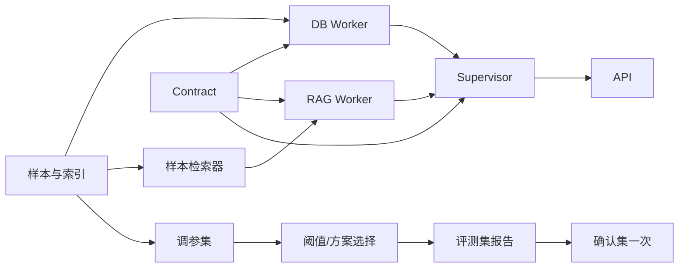

# Plan（事后补写）

> 本文写于 2026-10-11 20:05（PT）之后，即实现完成之后。它不是事前计划，仅用于补齐 Spec Kit 要求的 spec/plan/tasks 三件套，以便做一致性分析。

## 技术栈与边界

- Python 3.12（pyproject 目标 3.11），pydantic v2 Contract，FastAPI 入口，asyncio 编排。
- 复用 Project 1：`agents.rag_agent.RAGAgent`、`rag.techqa` 的 BM25 索引、重排器、父文档解析和阈值。只通过注入和包装扩展，不修改 Project 1 代码。
- 数据：样本 SQLite（docs、FTS、technotes、document_products），以及从 Project 1 全量向量中复制出的样本 MiniLM 向量附属文件。

## 模块与数据模型

| 模块 | 职责 | 依赖 |
| --- | --- | --- |
| contracts.py | 请求、TrustedContext、WorkerResult、各 payload、FinalResponse | — |
| planner.py | goal → 注册任务；请求 → 各 Worker 的输入 | contracts、Catalog |
| supervisor.py | 校验、授权、预算、并行派发、汇合、渲染 | planner、各 Worker |
| rag_worker.py | 用 Contract 包装 RAGAgent；状态映射 | Project 1 |
| db_worker.py | 参数化只读查询、产品推断、权限、限额 | 样本 SQLite |
| budget.py | 截止时间与分类调用上限；通过 ContextVar 计量 | — |
| dense.py | 样本 MiniLM 检索与重排 | Project 1 向量 |
| sample.py / evaluation/* | 样本构建、调参、对照评测 | 官方数据 |

## 阶段与依赖

## 并行判断

在 explain_and_data 中，RAG 与 DB 互不读取对方的结果，所以并行执行。若改为“先解析产品槽位、再同时用于 DB 和 RAG 过滤”，这一步只是确定性的槽位解析，并不读取另一个 Worker 的结果，因此并行性不变。只有当 RAG 的过滤条件依赖 DB 查询的输出时，才会出现真正的串行依赖。两种方案的比较见 spec.md §9。

## 质量门禁

- 只在调参集上选择参数；评测集只用于报告；确认集只运行一次。
- 每个任务提交时都在 tasks.md 记录改动内容、命令和实际结果。
