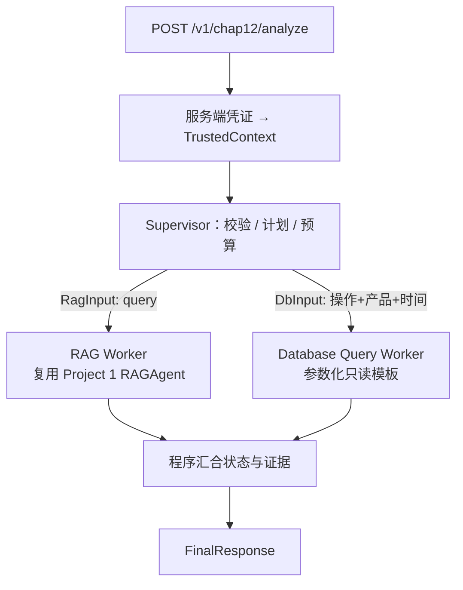

# Chap12 Supervisor–Worker（精简版）规格

状态：**实现已完成，待人工审阅**。本规格与实现同批交付，未经过“先审阅后实现”的流程；请审阅后再合并。
分支：`feature/chap12-supervisor-lite`。与 `specs/project2/` 的 v0.x 系列相互独立，不修改其中任何文件。

## 1. 范围与数据

- 数据：从官方 TechQA `training_Q_A.json` 中以固定种子 `20261011` 随机抽取 **150 题**（123 Y / 27 N）。
  语料为这 150 题官方 `DOC_IDS`（每题 50 篇候选：答案文档加官方干扰文档）的并集，共 **6,612 篇**，全部来自官方全文库，无合成文本。
- 选 training 而不选 dev：dev 的 held-out 部分按既有协议封存，本作业不触碰。
  已知偏差：复用的 Project 1 检索阈值是在 training 上标定的，所以 RAG 的绝对指标偏乐观；两个对照系统使用同一阈值，比较仍然公平。
- 产物（构建命令 `python -m evaluation.chap12_build_sample`）：
  - `.rag_data/chap12_sample.sqlite`：`docs` + FTS5 `search` + `vocabulary` + `manifest`（与 Project 1 `TechQAIndex` 同一 schema），另有结构化表 `technotes`、`document_products`；
  - `enterprise-ai-agent/evaluation/chap12/tasks.jsonl`：任务（只含问题文本）；
  - `.../gold.jsonl`：答案、标签、金标文档，**只供离线评分使用**，两个系统都读不到；
  - `.../sample_manifest.json`：种子、题号、源文件和索引的 SHA256。

## 2. 拓扑

- Supervisor 的计划是确定性的：`goal` 是一个枚举，`explain → [rag]`，`data → [database]`，`explain_and_data → [rag, database]`。不使用 LLM Planner，也没有 Replan。
- RAG 和 DB 之间没有数据依赖，所以**并行执行**（`asyncio`）。每个 Worker 只返回自己的结果对象，Supervisor 在两者都结束或总截止时间到达后才汇合，因此不存在共享 State 的写冲突。
- 模型可能参与的环节只有复用 RAG 内部的改写和证据选择。节点、工具和权限都由程序决定。

## 3. Worker 选型

| 候选 | 结论 | 理由 |
| --- | --- | --- |
| Database Query Worker | **采用** | 样本文档带有官方 metadata（productId/productName/date），可以构造真实的结构化查询；结果可以独立复算 |
| Analytics/Forecast | 不采用 | 没有业务时间序列或观测量，预测会是编造的 |
| Domain/API | 不采用 | 没有项目真正需要的外部服务 |
| Evidence Reviewer | 不采用 | Project 1 已有程序化引用校验和适用性复核；另做一个 Reviewer 只会重复这些检查 |

## 4. Contract（`agents/chap12/contracts.py`，版本 `chap12-v1`）

- `AnalysisRequest{query, goal, data_request?}`：拒绝未知字段，请求正文**不能**携带身份或权限。
- `DataRequest/DbInput{operation ∈ count_documents|count_by_year|list_recent_documents, product, date_from, date_to, doc_class, limit≤10}`。
- `TrustedContext{subject_id, tenant_id, allowed_workers, allowed_db_operations, allowed_product_ids}`：只由服务端根据凭证的 SHA256 映射构造（环境变量 `CHAP12_CREDENTIALS_JSON`）。
- `WorkerResult{contract_version, run_id, task_id, worker, status, payload, limitations, error{category, message, retryable}, usage}`。
  校验规则：`completed`/`partial` 必须带 payload；`permission_denied`/`timeout`/`failed` 必须带 error。
- RAG payload：answer、citations（source_id、doc_id、quote）、confidence、rag_status、rewritten_query、retrieved_doc_ids。
- DB payload：operation、产品名与 ID、时间范围、doc_class、metric（口径）、unit、count/rows、truncated、snapshot、query_template。
- `FinalResponse`：status、plan、answer、citations、data_result、limitations、worker_results、usage、trace。

### 状态定义

| Worker | completed | partial | no_data | permission_denied | timeout | failed |
| --- | --- | --- | --- | --- | --- | --- |
| RAG | 回答带有经过校验的引用 | 只回答了一部分 | 拒答或需要澄清 | 主体无 RAG 权限 | 超过截止时间 | 证据校验失败、依赖不可用、预算耗尽 |
| DB | 查询完整成功，**计数为 0 也算**（审阅决定 D1） | 按年分组结果超过 40 行被截断 | 列表查询返回空列表，或无法确定产品（clarification_required） | 操作或产品不在授权范围 | 截止时间到达（语句被中断，或线程在截止后试图发起新语句） | 参数非法、依赖错误、预算耗尽 |

### 汇合规则

两个任务都是必需的：

- 都是 completed → completed；
- 只要有一个是 completed 或 partial → partial，并在限制说明里列出缺失部分；
- 否则按 permission_denied > timeout > failed > no_data 的优先级取。

全部 36 种组合都有测试覆盖。凭证有效但没有任何 Worker 权限时，直接返回 permission_denied，不调用任何 Worker。

## 5. 权限、白名单与规模限制

- DB：不支持 Text-to-SQL。只有 3 个程序持有的参数化 SQL 模板，连接以 `mode=ro` 打开并设置 `PRAGMA query_only`。
  产品必须能在快照目录里精确匹配，否则在执行任何 SQL 之前就以 invalid_input 拒绝。
  每条查询都会带上授权的产品条件；越权时只返回 permission_denied，不透露数据是否存在。
  `list_recent_documents` 的 limit 不超过 10，按年分组不超过 40 行。
- RAG（审阅决定 D3，检索时过滤）：RagWorker 把 `TrustedContext.allowed_product_ids` 写入请求范围的 ContextVar。BM25 和 dense 两路都包了一层 `ScopedRetriever`：先多取（limit × 20，上限 1000），再按 `document_products` 只保留授权产品的文档，然后才进入 RRF 和重排，所以未授权文档不会进入重排器、父文档解析或 LLM 上下文。父文档展开前还会再检查一次，越界就抛错。受限主体的结果中会附带限制说明。DB 的产品推断也只在授权文档中进行，拒权时不会透露问题与哪个未授权产品相似。
- 沿用 Project 1 的过滤白名单和 `published` 强制过滤。检索范围限定在样本内：BM25 加上样本自己的 MiniLM 向量（从 Project 1 全量向量中复制），经 RRF 混合后重排。重排在 offline 档位用 MiniLM，在 ollama 档位默认用 nomic。全库 dense 服务会越出样本范围，所以不使用。

## 6. 预算与终止（`budget.py`、`metered.py`，Contract chap12-v2）

每个请求有一个绝对截止时间，并按类别设置调用上限，默认值为：

| 类别 | 含义 | 默认上限 |
| --- | --- | --- |
| llm | 模型生成调用 | 8 |
| embedding | nomic embedding 请求（缓存未命中的批次） | 4 |
| db | DB Worker 的逻辑查询和产品推断 | 4 |
| tool | Worker 调用 | 4 |
| sql | **每一条** SQL 语句，包括 RAG 的 BM25、父文档查询和 DB Worker 的语句 | 400 |
| local | 本地模型计算（MiniLM 查询编码） | 16 |

另外记录 nomic 缓存命中的文本数（`embedding_cache_hits`）。命中不产生外部调用，不设上限。截止时间默认 150 s。所有上限都可以用环境变量 `CHAP12_*` 修改；默认值由审阅决定 D4 确认。

- **调用前预留**：每次调用在开始前预留额度，失败、重试和取消的调用都计数。计数通过 ContextVar 进入复用的模型、重排 embedder、Project 1 的 `TechQAIndex`（由 `MeteredIndex` 包装每条语句）以及 MiniLM 编码，不修改 Project 1 代码。
- **线程内的截止语义（P0-3）**：检索、编码和 SQL 在 `asyncio.to_thread` 的线程里运行。到截止时间时，Supervisor 取消等待中的协程，但无法终止已经开始的线程。因此：
  - 每条 SQL、每次 LLM/embedding/本地编码调用前都调用 `charge()`；截止时间一过，它就抛出 `BudgetExhausted(deadline)`，被放弃的线程不能再发起新的调用；
  - 正在执行的 SQL 由 progress handler 在截止时间中断；
  - 已经开始的单次本地计算（例如一次编码）会继续跑完，但结果被丢弃。
- **重试**：DB 遇到 locked/busy 最多重试 1 次；RAG 证据校验重试沿用 Project 1 的上限（1 次）。
- Token 数：复用的 Ollama 适配层不返回 token。真实档位的采集方式见 P0-4。

## 7. 非目标

不做 Text-to-SQL、LLM Planner/Replan、Critic、写操作或 HITL、MCP/A2A、新的结果缓存，也不改动 Project 1 代码或旧的 `api.main`。

## 8. 已知限制

- 产品槽位优先使用问题中**字面出现**的目录产品名；没有时由 DB Worker 用自己的 BM25 前 3 篇文档推断，结果标注 `product_source=inferred`。推断仍无结果时返回 `no_data/clarification_required`。详见 `improvements.md`。
- 文档计数只反映样本快照的覆盖情况，不代表 IBM 全量知识库，也不是故障率或工单量。

## 9. 拒答信号（审阅决定 D2，P1-3）

只在调参集（种子 20261012，112 Y / 38 N）上研究；脚本 `evaluation/chap12_refusal_signals.py`，结果见 `evaluation/chap12/tune/refusal_signals.json`。上线规则在看结果之前就定好：**最佳 BA > 0.6 才采用**。

| 信号 | AUC | 最佳阈值 | Y 接受 | N 拒答 | 最佳 BA | 是否采用 |
| --- | --- | --- | --- | --- | --- | --- |
| top-1 重排分数 | 0.526 | 0.8109 | 0.143 | 1.000 | 0.571 | 否 |
| **top-1 与 top-2 分数间隔** | **0.635** | **0.0604** | 0.464 | 0.763 | **0.614** | **是（刚过门槛）** |
| 问题关键词在 top-1 中的覆盖率 | 0.483 | 0.9655 | 0.304 | 0.789 | 0.547 | 否 |
| top-3 最大词覆盖率 | 0.561 | 0.7955 | 0.223 | 0.895 | 0.559 | 否 |
| top-3 与问题产品的一致性（只有 66 题能识别出字面产品） | 0.511 | 1.0 | 0.432 | 0.636 | 0.534 | 否 |

- 结论：top-1 重排分数**没有拒答区分能力**（AUC 0.53）。只有分数间隔刚超过事先定好的门槛。“最佳 BA”是在调参集上取的最优点，偏乐观；同时比较了 5 个信号，存在多重比较的风险。它的代价也很大：在调参集上会拒掉约一半的 Y 题。
- 实现：只在 MiniLM 重排配置下生效（间隔是在这个配置上标定的）。间隔小于阈值时，所有候选的验收阈值都设为 1e9，Agent 因此拒答（no_data）。原来的 top-1 阈值 0.5404 仍然保留。设置 `CHAP12_GAP_GATE=""` 可以关闭这道门槛。真实效果以评测集和确认集为准。
- nomic 重排（真实档位）下没有标定过这道门槛，所以不启用；真实档位的标定步骤见 P0-4 脚本。

## 10. 产品槽位先行、同时过滤 DB 与 RAG 的替代方案（P1-5）

- 替代方案：先由程序解析产品槽位（字面优先，否则推断），再把它同时用于 DB 查询和 RAG 的检索过滤。这样 RAG 必须等槽位解析完成，变成串行。
- 调参集比较（`evaluation/chap12_product_filter_study.py`，112 道 Y 题，其中 98 题能解析出槽位，解析不出的退回不过滤）：

| 方案 | R@1 | R@3 | R@5 | R@8 | MRR | 额外延迟 |
| --- | --- | --- | --- | --- | --- | --- |
| 当前：不按产品过滤，与 DB 并行 | **0.464** | **0.554** | **0.625** | **0.688** | **0.535** | 0 |
| 替代：按解析出的产品过滤，串行 | 0.429 | 0.545 | 0.616 | 0.661 | 0.508 | 槽位解析平均 124 ms（p95 281 ms） |

- 语义上，替代方案会把“推断错的产品”（约 1/4，见 improvements.md）直接变成检索盲区；当前方案中，产品推断出错只影响数据部分。
- **结论：保留当前方案**（并行、RAG 不按产品过滤）。产品过滤只用于权限（D3）。

## 11. DB Worker 的业务关联（P1-5 重新论证）

- 在 explain_and_data 中，数据部分改为**同产品最近的相关文档列表**（doc_id、日期、标题，最多 5 篇）。用户可以直接点开核对，也可以作为“相关文档”与技术解释一起呈现。它与 RAG 证据互补：RAG 给出与问题最相似的片段，DB 给出该产品时间上最新的官方文档（例如新的 APAR 修复）。
- data 目标下保留三种模板查询。其中**文档计数是知识覆盖指标，不是业务指标**：它只说明样本知识库对某产品的覆盖程度，不能解读为故障率、工单量或产品质量。
- 是否真的帮助回答，用两个指标衡量：“相关文档列表包含金标文档”的比例，以及列表与原始数据独立复算的一致率（见 comparison.md）。
