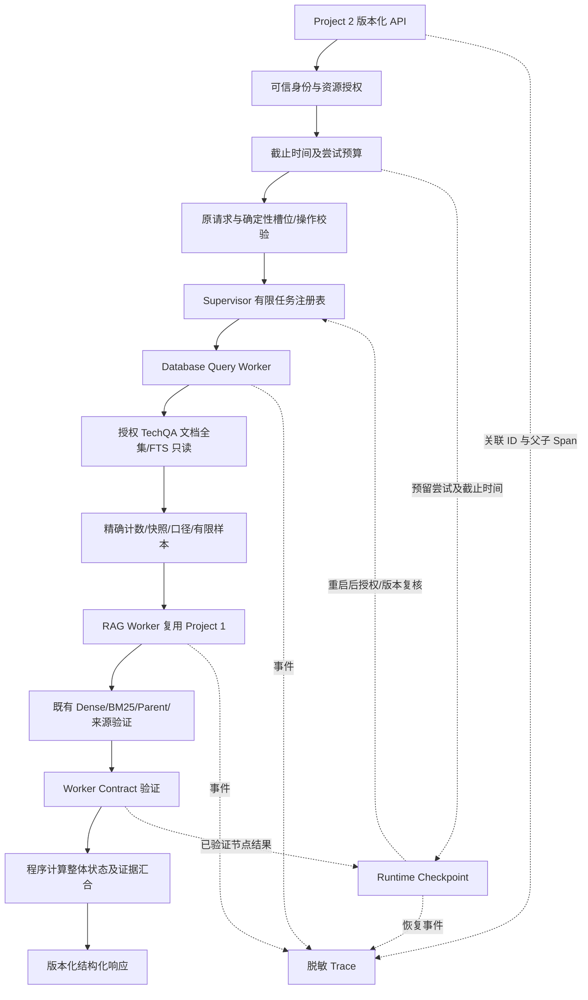

# Project 2 技术计划 v0.1

编制日期：2026-10-05。状态：待实现前审阅；人工审阅日期未发生、待填写。本文是计划，不是已实施清单。依赖 [spec.md](spec.md) 与 [clarifications.md](clarifications.md) 的批准；本阶段只写文档，不改源码、不运行评测。

## P01 最小变更边界

在 `enterprise-ai-agent` 新增 Project 2 模块，复用已有 Project 1 `agents.rag_agent`、schemas、Settings 和共享 `rag.techqa` 只读文档/检索。新应用使用独立 ASGI 入口，不给现有 `api.main` 注册新默认行为，不改 `agentic-rag-homework/agents/systems.py` 的 MultiAgentVersion。

| 拟新增边界 | 拟定位置（尚不存在） | 职责与最小变更 |
| --- | --- | --- |
| 版本化 API | enterprise-ai-agent/api/project2_main.py | 新 app、严格请求/响应、可信身份上下文、请求预算、调用 Supervisor；现有应用保留 |
| Contract | enterprise-ai-agent/models/project2.py | 请求/槽位跨度、两 Worker 外壳、六状态、计数口径/快照、整体结果、错误分类 |
| Policy | enterprise-ai-agent/agents/project2/policy.py | 主体/资源/操作白名单和 Resume 访问检查；凭证不进入模型 |
| Budget | enterprise-ai-agent/agents/project2/budget.py | 截止时间、尝试预留、LLM 子预算、取消/未知成本；新 API 默认不可绕过 |
| Supervisor | enterprise-ai-agent/agents/project2/supervisor.py | 固定注册路由、DB→RAG、36 组合状态汇合、程序渲染、限制 |
| 数据查询 Worker | enterprise-ai-agent/tools/techqa_document_query.py | 三种只读查询模板、FTS phrase 参数/范围、全母体不同文档计数、有限例示 |
| RAG Adapter | enterprise-ai-agent/agents/project2/rag_adapter.py | 复用现有 RAG；保留来源/原问题/trace；把依赖失败与无证据区分；注入本请求预算 |
| Runtime | enterprise-ai-agent/agents/project2/runtime.py | Chap13 独立状态库、运行身份、尝试/节点事务、同 ID 恢复；不是评测进度文件 |
| Trace | enterprise-ai-agent/agents/project2/tracing.py | 跨 API/Worker/工具/恢复关联，脱敏、保留和访问策略 |
| 配置/文档 | 新 Project 2 示例配置和 README 小节 | 只记录非 Secret 初值、入口、数据/规则版本、状态/预算与停止方式 |
| 测试 | enterprise-ai-agent/tests/project2/ | 核心 Worker、Policy、Budget、Supervisor、Runtime、API 的独立测试命名空间 |

若现有模型/检索依赖不能接受预算注入，优先在新应用组合依赖时包装接口；只有无法覆盖内部实际调用的跨服务预算才提出明确的兼容性补丁。补丁必须另经审阅、有默认不变测试，不能把只有外层 HTTP 计量的方案写为已完成。不得复制 P1 整套生成/检索实现。

## P02 数据流与状态所有权

RAG 与 DB 共用源快照但不共用候选集合。DB 输入不包含 RAG 排名；DB 的 doc_id 仅来自合法查询结果。原题、RAG query、数据库 predicate 分栏，QA 答案/目标/标签 sidecar 在在线进程之外。最终答复由 Supervisor 写；Worker 不覆盖原请求或其他 Worker 的结果。

## P03 数据与查询实现方向

复用现有 SQLite `docs`/FTS `search`，不新造业务库、不修改原表/QA 文件；只读参数化 COUNT 与两组交集模板，COUNT 无 Top-k。使用已登记 tokenizer、参数转义和服务端范围；原 metadata 不参与未核实指标。样本最多 20 行，计数不受样本 limit 影响。

实现前核对只读 FTS COUNT、授权范围过滤及取消语义是否同时可满足；仅做新 Worker 的测试时使用官方 technote 切片并保留出处，不能用编造文档构造成功结果。非法请求/身份/计时故障可用 Contract Mock，证据分类明确。全量计数超时是真实风险，应返回不完整状态；本阶段不测吞吐、不取新统计值、不增加独立全文副本。

## P04 Runtime 与恢复方向

拟用独立 SQLite Runtime 文件保存状态，语料索引只读。owner/tenant、版本、预算预留和节点结果事务化；同一个 run_id 的重复 Resume 不应并发重复调节点，使用运行租约或等效确定性排他。未知/损坏/过期/越权/版本变更的状态不静默新建任务。

绝对截止时间跨重启保留；超过截止时间只能终结为 timeout/partial，不通过 Resume 获得新预算。实验续跑目录不接入服务。验证应真实停止服务/Worker 进程，在预算仍有效时重启并恢复；不把同进程对象重新创建算进程恢复。完成结果返回前再次验权，取消调用成本未知保持 null。

## P05 Chap14–16 的增量边界

Chap14 为实际服务创建容器拓扑，挂载只读索引与独立可写 Runtime，明确本地卷不是云备份。Compose 仅纳入实际依赖。

Chap15 对该版本化路径登记可重试/不可重试错误、相同请求/数据/授权/缓存条件的重复对照；默认不增加结果缓存或并行。现有缓存模型/文本/数据版本和返回前授权边界不能遗漏。

Chap16 在另获授权后选择平台；真实 Endpoint、关键状态恢复、Cloud Log/Agent Trace 关联诊断及停止资源证明分别交付。此阶段文档不包含安装/部署执行结果、资源报价或平台签收。

## P06 风险登记（均未实测）

| 风险 | 影响 | 后续动作/约束 |
| --- | --- | --- |
| 全量约 **309 万 Chunk**，另有全文/模型与索引 | 后续容器镜像、构建上下文、挂载、启动、内存/磁盘和云持久存储可能成为约束 | **本阶段只记风险，不评估体积/资源/费用，不构建、不测量**；不能许诺免费平台可容纳全量 |
| 全库词项计数与交集耗时不确定 | 临时12秒SQL/25秒Worker/90秒请求可能不适合 | 按S08.1只在tune进行40题×3标定；预算删失不能用成功子集估值；冻结前记录报告/参数哈希，超时不报精确计数 |
| FTS porter/unicode61 的词干和标点语义 | 命中词项不等于精确字符串或产品适用性 | 返回 rules 版本及 limitations；对版本边界和歧义做官方文档测试 |
| 共用 TechQA 被误当 RAG 换皮 | Chap12 核心 Worker 合格性存疑 | 草案已采纳COUNT Worker，最终选型待确认；AC12-11/AC12-13必过，全母体复算/无LLM独立运行/候选不变性提供证据 |
| 模型超时/错误和审核误拒 | 默认状态/事实质量不满足生产要求 | 新入口不默认加入 Critic；引用/权限验证保留，仍做独立事实验收 |
| 现有服务内部调用预算不可观测 | 外层截止不能证明内部计算已停止或次数有界 | 提交最小跨服务预算补丁方案；未测不得签收总预算 |
| Resume 版本/权限变化及重复并发 | 旧证据泄漏、预算重置或重复昂贵调用 | 同 owner/范围复查、版本绑定、尝试持久预留和并发恢复测试 |
| 评测与业务服务耦合 | target/answer/gold 泄漏，污染对照 | 输入 Contract 拒绝评分字段、依赖隔离；在线访问不得打开 QA/sidecar |

## P07 审阅与验证计划

CL-01/02/04/05/06/07已按本次修改指令采纳草案。实现前完成CL-03课程口径、CL-08协议和CL-05最终选型确认；用户本人签署真实审阅日期与批准版本哈希，不由编制者代签。任务原问题/类型已按S01登记在task_preregistration.json，改动须升版本并更新追踪。实现后按tasks分阶段验证；先审阅并标定，再冻结实际预算文件和哈希，不能把临时90/16/6当最终值。证据写入新Project 2目录，不覆盖v0/旧结果。

当前阶段唯一可运行脚本是用户指定的check_docs.py；它只作文件/CSV/ID/哈希/输入/状态一致性检查，不调用应用或评测，不能填入系统验收实际结果。业务无答案挑战AC12-23预先写定sample与状态；真实证据充分必须报告未满足预期，不重选样本。行政/部署类场景中的状态明确指附带探针，不把资源停止当作服务已返回failed。

本阶段没有源代码改动清单中的任何实现。Push/PR/合并、云操作与系统级安装均等待用户另行授权。
