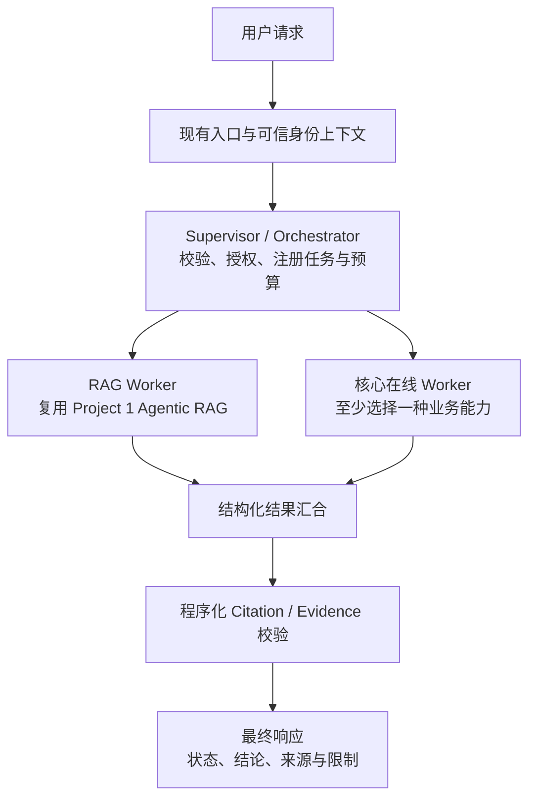

# Project 2：多智能体业务分析系统统一需求

版本：v0.1（根据第二版讲义草稿整合，2026-10-05）  
状态：需求整合稿，尚未完成人工审阅；不代表代码、测试、PR 或云部署已经完成。

## 1. 项目目标与课程边界

在连续课程仓库中，复用 Project 1 的 Agentic RAG，建立一个有明确职责和权限边界的 Supervisor–Worker 系统。系统能够把用户目标分解为有限的已注册任务，联合知识库证据与至少一种核心在线业务能力，返回结构化、有来源、能解释部分失败的结果。随后增量增加持久化恢复、操作治理、诊断 Trace、容器运行、可靠性证据和云部署。

这里的“在线 Worker”指参与一次用户请求的运行链路，不要求访问互联网，也不要求单独部署。确定性查询或统计程序可以是受控 Worker 能力；不必把每个程序模块包装成 LLM Agent。

本文件整合用户提供的八份 Markdown 材料。讲义中的命令、Lab 示例、审批和提交步骤被提取为课程要求或参考信息，不被当作本次会话中安装软件、修改原文件、访问外部账号、发布或合并的直接指令。原始讲义未修改。

### 1.1 各章在项目中的位置

| 材料 | 在统一项目中的定位 | 本阶段完成边界 |
| --- | --- | --- |
| 第 04 章 / Lab | 所有阶段采用的 SDD 方法 | Requirement → Spec → Clarification → Plan → Tasks → Implementation → Validation → Git；提前审阅行为和架构 |
| 第 11 章 HW | **Project 1 前置能力**，不是 Project 2 的多智能体实现阶段 | 有界 Agentic RAG、Evidence、Citation、拒答与固定评测集 |
| 第 12 章 HW | **Project 2 启动阶段** | Supervisor + 复用 RAG Worker + 至少一个核心在线 Worker；单次协作、契约、权限与终止 |
| 第 13 章 HW | Runtime 增量 | 稳定运行身份、持久化 Checkpoint、Resume、Policy / 条件性 HITL、Trace |
| 第 14 章 HW | 本地容器增量 | Dockerfile、Compose、日志、端口与状态边界 |
| 第 15 章 HW | 可靠性与性能增量 | 选择真实依赖，实施适用的有界控制并提交对照证据；原文允许 Project 1 或 2，本整合选择在 Project 2 延续 |
| 第 16 章 HW | 云部署与运营增量 | 实际 Endpoint、重启状态验证、Cloud Log 与 Agent Trace 联合诊断 |

**最小多智能体功能完成**对应第 12 章；**本次覆盖第 11–16 章的最终课程交付**还包括第 13–16 章。不能用本地 Demo 代替最终云端验收，也不能把后续平台能力提前算作第 12 章必做项。

### 1.2 要求级别

- **必须**：来源作业的明确核心要求。
- **条件性必须**：触发相关业务或架构条件后必须完成，如真实写操作、Text-to-SQL、远程 Agent、Cache。
- **可选**：可以不实现，适用时写清取舍；不能通过数量堆叠替代核心要求。
- **建议草案**：本整合为了推进实现提出的业务、契约或实现选择，尚未成为讲义硬性要求。

## 2. 前置依赖与项目连续性

| ID | 必须满足的要求 | 来源 |
| --- | --- | --- |
| PRE-01 | 延续课程仓库、接口、配置、依赖管理及 Git / PR 流程；阶段增量不能用脱节 Toy Project 替代 | 11–16 |
| PRE-02 | Project 1 已有可调用的查询入口、Retriever、来源信息、权限过滤与 Agentic RAG；缺失时先补齐 | 11、12 |
| PRE-03 | 沿用第 07 章 Golden Dataset、第 08 章检索评测；扩充同一权威数据集，避免冲突副本 | 11 |
| PRE-04 | 读取项目 Constitution / Rules、README、相关模块和测试；记录当前行为与已知失败 | 04、11–13 |
| PRE-05 | Project 2 有至少一种实际适用的结构化查询、分析 / 预测或领域 API 能力及合法数据范围 | 12 |
| PRE-06 | 最终部署前确认平台权限、届时价格 / 免费额度、区域和外部访问限制 | 16 |

尚未提供的材料：现有 Project 1 / 2 代码仓库、Golden Dataset、第 08 章评测结果、模型配置、业务数据 / API、可信身份来源和云环境。因此本次完成需求与实施工件；上述系统能力仍待在真实仓库中核验。

不将第 07–08 章未提供的完整要求补写为已确认条件，只保留本批讲义明确引用的前置依赖。

## 3. 业务方向与最小拓扑

### 3.1 建议业务方向：有证据的经营分析

建议以讲义第 12 章示例为起点：

> 分析 Product A 第二季度销售下降，并结合我有权限访问的企业资料说明可能因素。

系统先核实数据是否确实下降，再计算变化，联合知识库中的相关资料提出**可能因素**及其证据限制。如果数据未下降，应明确纠正用户前提；只有相关性或文档线索时不能声称已经证明因果。

这是待结合现有数据确认的实施草案。实际项目若已有其他领域，应保留该领域，只替换业务对象、指标与合法来源，保留统一协作和验收边界。

### 3.2 最小系统

核心在线 Worker 至少选择一种：Database Query、Analytics / Forecast、Domain / API。建议在已有销售数据可用时选择 **Database Query Worker**，采用受限参数化聚合查询。简单同比 / 环比计算保留为普通程序，不强制新增第三个 Worker。

| 组件 | 核心职责 | 权限 / 边界 |
| --- | --- | --- |
| Supervisor | 将用户目标映射到有限任务；调度、预算、状态汇合、最终响应 | 模型可提出语义计划，程序校验注册任务、权限与预算；不能生成任意可执行节点 |
| RAG Worker | 有界改写、复用 Retriever、上下文处理、证据化回答 | 既有服务端权限过滤；原 Query 和检索 Query 分开保存 |
| 所选核心在线 Worker | 查询真实业务数据、调用已登记模型或合法领域服务 | 只处理已授权范围；返回来源、口径、状态与限制 |
| 程序化校验 / 计算 | Schema、Citation、数值口径和有界执行检查 | 普通程序步骤，不因命名而计作新增 Agent |

可选的 Metadata Enrichment 属于接入 / 索引预处理时，不计作核心在线 Worker。Evidence Reviewer 也不能代替上述至少一个核心 Worker。

## 4. 功能要求

### 4.1 Agentic RAG 前置能力

| ID | 可观察要求 | 来源 |
| --- | --- | --- |
| RAG-01 | 原始 Query 保持不变，实际检索 Query 单独记录；改写不无依据改变意图或引入新事实 | 11 |
| RAG-02 | 明确定义空改写、无有效改写和已知依赖失败的回退；不吞掉未预期异常 | 11 |
| RAG-03 | 复用现有 Retriever / Adapter 和服务端权限过滤；候选保留稳定 chunk_id、文档、位置及排序 / 评分信息 | 11 |
| RAG-04 | 排序、筛选或压缩具有明确上限；处理后仍可映射到原始 Chunk | 11 |
| RAG-05 | 输出答案、Citation / Evidence、可答性或证据覆盖状态；引用只来自本次实际提供给模型的来源 | 11 |
| RAG-06 | 空结果、证据不足或 Citation 无法校验时明确拒答或说明限制，不返回确定性成功 | 11 |
| RAG-07 | 若使用 confidence，说明生成和验证方法；未经校准的模型自评分不能称为正确概率 | 11 |

### 4.2 单次多智能体协作

| ID | 可观察要求 | 来源 |
| --- | --- | --- |
| MA-01 | 中心化 Supervisor 调用复用的 RAG Worker 和至少一个核心在线 Worker | 12 |
| MA-02 | 用户目标仅映射到有限已注册任务；未知任务、未注册能力和越权调用不能执行 | 12 |
| MA-03 | 每个 Worker 定义输入、输出、数据来源、权限、状态、错误和 Supervisor 继续 / 停止条件 | 12 |
| MA-04 | State 包含目标、任务计划 / ID、Worker 结果、错误、部分完成、审查反馈（若使用）与最终响应；说明字段读写方 | 12 |
| MA-05 | Worker 交换结构化必要上下文，不共享无界完整聊天历史 | 12 |
| MA-06 | completed、partial、no_data、permission_denied、timeout、failed 的含义和处理明确；按 Worker 能力适配，不把失败映射为空成功 | 12 |
| MA-07 | Retry 上限与程序终止条件明确，Agent / Tool / 模型服务调用受总预算约束 | 12 |
| MA-08 | 若 Replan，改变计划只能选择注册任务，并重新校验权限、依赖与预算；与 Retry 区分 | 12 |
| MA-09 | 仅无数据依赖且允许并发的分支可并行；定义结果汇合、超时、失败和 State 写冲突处理 | 12 |
| MA-10 | 关键主张保留 Evidence 映射；证据不足、数据冲突或前提不成立时明确限制或纠正 | 12；业务草案细化 |

### 4.3 可恢复与可治理 Runtime

| ID | 可观察要求 | 来源 |
| --- | --- | --- |
| RT-01 | 一次运行有稳定标识，并与可复用 Graph / Workflow 定义区分；不同运行及主体的 State 隔离 | 13 |
| RT-02 | 至少一条多步骤路径使用持久化 Checkpoint；定义最小 State、写入时点、可恢复状态、终态、过期 / 清理和敏感数据处理 | 13 |
| RT-03 | 实际停止、重启进程后，使用同一标识恢复；未知任务、非法状态和越权读取 / Resume 明确失败 | 13 |
| RT-04 | 恢复跳过已成功的昂贵只读 / 可缓存步骤；不确定结果先核实，不能无条件重做副作用 | 13 |
| RT-05 | 可信程序执行主体、资源、动作授权；区分允许的只读、需审批的写动作和拒绝 / 强审批的高风险动作；LLM、Prompt、Schema 或 UI 按钮不构成授权边界 | 13 |
| RT-06 | 真实需审批的动作先持久化目标、证据与草稿 / 版本，再暂停；认证审批绑定运行和动作，执行前再次授权 | 13；有相关动作时 |
| RT-07 | 审批覆盖批准、拒绝、超时 / 过期、动作变更、执行失败及重复恢复；有副作用路径定义幂等或不确定状态处理 | 13；有相关动作时 |
| RT-08 | Trace 关联请求、Supervisor、Worker、工具、重试、Checkpoint / Resume 与审批（若适用）；包含父子 Span、耗时、状态、错误类别等必要字段 | 13 |
| RT-09 | Trace 定义访问权限、脱敏与保留；至少一次可重复失败 Trace 用于定位实际失败阶段 | 13 |
| RT-10 | MCP / A2A 采用与否有需求依据；采用时补齐真实服务边界、身份、授权、契约和协议测试 | 13 |

若现有 Worker 全部只读：如实说明当前风险与未来写操作策略，不新增真实危险操作。第 13 章允许用**明确隔离、不连接真实系统的 Fake Publish**演示暂停、批准与拒绝；该演示不能充当真实业务写能力或外部副作用安全性的验收证据。

### 4.4 容器、可靠性和云运行

| ID | 可观察要求 | 来源 |
| --- | --- | --- |
| ENV-01 | 每个实际独立运行的服务有适配入口和依赖的 Dockerfile；不复制宿主机 .venv | 14 |
| ENV-02 | Compose 描述实际服务、网络、端口、变量、依赖和适当健康检查；容器间使用 Service Name 与容器端口 | 14 |
| ENV-03 | .dockerignore 排除无关文件及 Secret；真实 .env、凭证不进入 Git、Build Context 或 Image | 14、16 |
| ENV-04 | 明确内存、容器可写层、开发 Volume 与外部持久状态；能说明重建后哪些状态保留 | 14 |
| ENV-05 | stdout / stderr 日志能诊断至少一种启动或请求问题；TCP 可连接不等于业务健康 | 14 |
| ENV-06 | 干净 Docker 环境启动后，至少一次真实 Project 2 合成请求走完既有主流程；停止时不误删保留卷 | 14 |
| REL-01 | 选择真实下游依赖，记录契约、故障类别、副作用和端到端预算 | 15 |
| REL-02 | 按故障选择适用的 Timeout、错误分类、有限 Retry / Backoff、Circuit Breaker 或 Fallback；说明未选策略 | 15 |
| REL-03 | 无效输入、权限拒绝和 Policy Violation 不无条件重试；Fallback 明确缺失能力，不能冒充完整成功 | 15 |
| REL-04 | 写路径验证重复提交 / 成功但响应未知；使用 Cache 时验证 Tenant、Permission、Query、数据 / Prompt Version 与失效边界 | 15；按路径适用 |
| REL-05 | 相同合成 / 脱敏输入重复比较延迟、调用数、可用 Token / Cost；通过 Trace 或结构化日志诊断、修改、复测 | 15 |
| CLOUD-01 | 在 Render、Railway 或课程批准的等价平台运行已有真实项目服务，实际验证 Endpoint Health 与合成 Agent 请求 | 16 |
| CLOUD-02 | Runtime Variables / Secret 管理、监听端口、最小权限和外部状态与实际配置一致 | 16 |
| CLOUD-03 | 验证关键状态在预期重启 / 重部署后是否可恢复；平台限制与未验证部分如实记录 | 16 |
| CLOUD-04 | 非生产环境可控问题通过非敏感 request_id / trace_id 关联 Cloud Runtime / HTTP Logs 与项目 Agent Trace；修复后同条件复测 | 16 |
| CLOUD-05 | README 提供部署、验证、停止资源步骤和费用 / 限制；核对停止后残留计费资源 | 16 |

## 5. Worker 与响应契约：建议草案

本节是把讲义要求落成可审查接口的草案。实际实现应优先适配现有公共类型和 API，不要求增加新 Web 框架或另建入口。

### 5.1 请求与可信上下文

用户输入至少包含业务目标及必要参数，例如业务对象、时间范围、指标。认证主体、Tenant 和权限来自服务端可信上下文，不能由请求正文中的自报身份、自然语言或模型计划授予。

推荐区分：`request_id`（一次入口请求）、`run_id`（可恢复运行实例）、`trace_id`（诊断关联）。如果已有 Runtime 使用 `thread_id`，明确其映射和隔离语义；不能简单用 user_id 作为所有运行共享的 State Key。

### 5.2 统一 WorkerResult 外壳

| 字段 | 推荐含义 |
| --- | --- |
| run_id / task_id / worker | 运行、任务与注册能力标识 |
| status | completed / partial / no_data / permission_denied / timeout / failed；按能力声明支持项 |
| payload | Worker 专属、经 Schema 校验的业务结果 |
| evidence | 来源定位、适用范围、数据 / 模型时间或版本；文档 Evidence 与数据 Evidence 区分类型 |
| limitations | 缺失数据、证据覆盖、模型假设和时效限制 |
| error | 安全错误类别与是否可重试；不返回原始凭证或完整敏感报错 |
| usage | 可用调用数、耗时、Token / Cost；不可得项记 null，不伪造估算为实测 |

RAG payload 保留 `original_query`、`retrieval_query`、answer、可答性 / 覆盖状态与 Citation；每条引用能够映射到本次实际送入模型的来源。

Database payload 至少保留指标名称 / 定义、单位 / 币种、时间范围、业务对象、聚合结果、数据源及数据版本 / 截止时间（可得时）。查询范围由服务端授权收窄；缺失、空值和零值不能混淆。

Analytics payload 若采用，补充登记模型 ID / Version、输入数据来源、粒度、目标变量、Horizon（预测时）、不确定性、假设与适用范围。模型不能生成并执行任意代码。

Domain / API payload 若采用，补充服务 / 操作标识、业务对象、结果单位 / 状态、数据时间与限制；目标、操作、参数白名单与凭证由服务端控制。

### 5.3 Supervisor 汇合策略

| Worker 结果 / 边界 | 建议的整体响应语义 |
| --- | --- |
| 所需结果完整，关键主张有证据 | completed |
| 缺少资料线索，但有完整合法业务数据 | partial；可以报告数值，不能编造原因 |
| 缺少业务数据，但有合法资料 | partial 或 no_data（按最终 Spec）；不能确认销售下降幅度 |
| 所需来源均无有效数据 / 证据 | no_data；明确无法回答 |
| 不允许执行当前目标或范围 | permission_denied；不执行越权任务、不泄露受限内容 |
| 超时 / 失败，但有可安全返回的独立结果 | partial；说明未完成步骤 |
| 必要步骤失败且无法给出有效结果 | failed 或 timeout（按最终 Spec）；明确失败位置 |
| Citation / Contract 校验失败 | 拒绝该无效结果；可按预算修正，达到上限后明确失败 / partial |

整体状态必须由程序根据所需任务和合法结果汇合，不能仅由模型文字判断。权限拒绝是否允许其他独立合法任务继续，需在 Spec 明确；建议对本次未授权目标终止，用户另提合法请求。

最终响应建议包含：整体状态、summary、observed_metrics、claims、evidence、limitations、worker_statuses、run_id / trace_id。每个重要 Claim 关联 Evidence，并区分事实、推断、假设。程序化引用校验只能证明引用合法存在，不能自动证明因果或语义支持。

## 6. 条件性要求与非目标

| 项目 | 实施条件 | 不采用时需说明 |
| --- | --- | --- |
| Text-to-SQL | 业务确实需要模型产生 SQL | 采用受限模板 / 现有服务时不要求 Text-to-SQL；如采用，须只读、Schema / 表白名单、租户 / 行权限、解析校验、参数化、Timeout、规模上限 |
| 并行 | 分支独立且允许并发 | 无真实机会可串行；采用时说明 Rate Limit、成本、负载与 State 合并 |
| Critic / Reflection | 有明确审查价值 | 可不采用；采用时结构化反馈、最大 Retry、显式终态 |
| Replan | 需要改变任务计划 / 补充信息 | 可保留固定有限计划；采用时重新校验注册表、权限与预算 |
| Evidence Reviewer | 独立语义审查确有价值 | 不取代 Citation 校验或核心在线 Worker；采用时测不支持的引用、过强措辞、冲突与 Reviewer 失败 |
| Metadata Enrichment | 数据接入需要 metadata 建议 | 不计作在线 Worker；采用时证据、校验 / 人审、幂等重跑，不改 ACL / Tenant / 安全字段 |
| 项目专属 Worker | 存在目录外的独特业务能力 | 证明职责、数据 / 工具权限与验收区别；格式化、解析、权限检查和普通数值计算不自动算作 Agent，也不替代核心在线 Worker 最低要求 |
| 真实 HITL | 真实动作有审批需求 | 只读项目说明风险与未来策略；可隔离 Fake Publish 演示，明确与真实项目证据分开 |
| MCP | 外部系统存在可复用标准能力接口需求 | 保留现有 API / Adapter；采用时真实 Host / Client / Server 与服务端治理 |
| A2A / 等效远程契约 | 独立部署 Agent 有自身任务生命周期 | 本地节点保留简单接口；采用时身份、能力、任务状态 / 产物、失败 / 取消与 Trust Boundary |
| Queue / 独立 Worker Service | 确有长任务 / 流量需求 | 不因作业新增；采用时说明 API / Queue / Worker / Checkpoint 的恢复与扩展 |
| Cache / Circuit Breaker / Fallback | 所选故障 / 性能边界适用 | 分别解释未采用原因；不是机制全选题 |
| LangSmith | 项目需要并选择该产品 | 可用现有 Trace / 结构化日志；不替代 Checkpointer、Authorization、Audit 或平台 Runtime Logs |

本项目不要求开放式自治、多 Agent 自由互聊、无限循环、任意代码执行、新增登录产品、Dashboard、全新向量数据库、长期 Memory、强制微服务拆分、HA / 灾备、未经验证的生产 SLA 或额外付费云资源。若业务确需扩展，作为独立变更说明，不能静默扩大本次范围。

## 7. 评测与证据要求

### 7.1 三次不同的对照

| 阶段 | 对照对象 | 必须回答的问题 |
| --- | --- | --- |
| 第 11 章 | 原 RAG vs Agentic RAG，同一固定 Query Set | 哪些 Query 改善、无改善或退化？来源 / Citation、拒答、延迟与新增调用代价如何？ |
| 第 12 章 | 单 Agent / 既有 Workflow vs Multi-Agent，同一固定任务集 | 完成度、Evidence / 数据质量、延迟、调用 / Token / Cost、失败率有什么变化？ |
| 第 15 章 | 所选路径改动前 vs 改动后，可安全比较 | 有界控制解决哪类故障？性能变化、调用数、缓存状态和诊断复测证据是什么？ |

复用一个权威评测源；为 RAG Query 与多智能体任务维护不同类型 / 子集标记。不同阶段可增加版本化样本，但同一次对照使用相同输入、权限、数据版本和可解释配置。原单 Agent 不支持的任务如实记为不支持，不能伪造成同能力的成功基线。

至少包含明确可答、需改写 / 上下文理解、知识库无答案；多智能体再覆盖完整成功、业务无数据、部分结果、权限拒绝、超时和失败。所选 Worker 的专属边界必须覆盖。

报告记录案例 / 版本、样本量、预期与实际状态、来源和口径、耗时、各类调用数、可用 Token / Cost、失败类别、Mock 范围、外部 Provider 波动及未覆盖项。没有测量值时标为“未执行 / 不可得”，不填写拟造数值。

### 7.2 测试证据与真实集成证据

- Unit / Contract 测试可用 Mock 验证控制流、错误分类和边界，但不证明真实模型、检索、业务服务或云环境已经通过。
- Project 主流程使用真实实现处理合法的合成 / 脱敏数据；合成数据不等于 Fake Worker。
- Fake Publish 仅在第 13 章明示条件下作为隔离审批演示；不能扩展为其他阶段免除真实实现的理由。
- Trace 解释一次执行；Evaluation 判断任务质量；Runtime / Container / HTTP Logs 解释服务运行。三者互相补充，不互相代替。
- 性能结论来自重复对照；注明样本量和局限，不把小样本、Mock 或单次耗时写成 SLA。

## 8. 分阶段交付与最终完成定义

| 阶段 | 交付与进入下一阶段的条件 |
| --- | --- |
| P0：前置核验 / 第 11 章 | 可调用真实 Agentic RAG；Query / 来源 / 权限 / 拒答测试；Golden Dataset 版本与对照；未完成前置能力先补齐 |
| P1：第 12 章 | Spec / Plan / Tasks 经审阅；Supervisor 与两个必需 Worker 能力可运行；契约 / 权限 / 失败 / 预算测试；固定任务对照；Feature PR |
| P2：第 13 章 | Runtime State 与状态图；持久 Checkpoint；实际进程重启 Resume；治理 / 条件性 HITL；重复或不确定边界测试；失败 Trace；协议决策；Feature PR |
| P3：第 14 章 | Dockerfile / .dockerignore / compose.yaml / .env.example；真实拓扑；干净构建、健康检查、核心合成请求与服务日志；状态 / 停止说明 |
| P4：第 15 章 | 真实依赖故障设计；有界策略与测试；适用副作用 / Cache 边界；重复性能对照；诊断和复测；README；Feature PR |
| P5：第 16 章 | 实际部署配置 / Endpoint；Health 与核心请求；状态存储清单与重启验证；Cloud Log + Agent Trace 根因 / 修复 / 复测；停止资源、费用与限制；Feature PR |

每阶段记录实际运行命令与结果，执行项目已有测试 / 静态检查 / 质量门禁，检查 Diff 与计划外变更。使用 Feature Branch 与 PR，在课程仓库规则下审查通过后合并。默认分支按真实仓库配置；讲义示例中的 main 和 feat/* 不要求覆盖现有命名约定。

**最终 Done**：前置依赖成立，第 12–16 章全部必须要求及已触发条件性要求都有对应实现与可复现证据；可选项有适用决策；README 能复现；Secret / 未授权数据未进入提交与日志；审查流程符合课程仓库规则。只有文档、生成代码、架构图、配置截图或 Mock 测试不能单独满足最终 Done。

详细执行草案见 [实施方案与任务](Project2_实施方案与任务.md)，逐条来源见 [需求追踪表](Project2_需求追踪.csv)，待执行验收场景见 [验收场景表](Project2_验收场景.csv)。追踪表还将 SDD、所选 Worker 的条件性边界、评测与 PR 要求编号，所有条目均保持“待实施 / 验证”，验收实际结果保持“未执行”。

## 9. 第二版讲义需要统一的表述

1. **11–16 的课程覆盖 ≠ 第 11 章已经启动 Project 2。** 建议总标题写成“第 11 章准备 Project 1 RAG Worker，第 12–16 章连续完成 Project 2”。
2. **同一仓库的含义需要总纲明确。** 第 11 章指定 Project 1，第 12 章同时使用“连续 Project 2”和“同一课程 Project 仓库”。建议总纲明确：本整合默认同一课程仓库承接两个项目；若课程实际安排不同仓库，必须指定 RAG 的版本化复用契约和评测来源，不能各自重做。
3. **第 15 章的项目选择。** 原文允许 Project 1 或 2；在 Project 2 总作业中明确选择 Project 2，避免学生在第 14 与第 16 章之间切回另一个项目。
4. **Spec Kit 命令的版本定位。** 第 04 章 Lab 固定记录版本且要求执行时看本机帮助；后续 HW 也以本地版本为准。本整合保留流程要求，不把 Lab 的命令集合或安装版本当作已验证现行配置，也未执行初始化。
5. **Fake 禁令的例外。** 真实 RAG / Worker / 云诊断不能用 Lab Fake 代替；第 13 章只读项目允许隔离 Fake Publish 做审批演示。应在项目总纲直接写明该例外及证据边界。
6. **审批交付的条件性。** 第 13 章提交物列出批准 / 拒绝记录，但前文同时要求不为只读项目虚构危险操作。建议写为“真实需审批动作的证据；只读项目可附隔离演示，并提交当前风险与未来策略说明”。
7. **Trace 的阶段职责。** 第 13 章形成项目 Trace，第 14 章区分容器日志，第 15 章用于可靠性诊断，第 16 章与云日志关联。第 14 章所提第 15 章 Trace Lab 没有提供，本整合不补造其额外验收要求。
8. **Agent 数量和协议数量不作为完成度。** Supervisor + RAG + 一个核心在线 Worker 已满足第 12 章最小结构；Reviewer、Metadata、MCP、A2A、Queue 和独立服务均按真实需求决定。

## 10. 本稿来源

源目录：`C:/Users/zacha/Desktop/学习/直通硅谷/Program 2/`

- `Chap04.md`：SDD 概念、规格内容、范围与验证闭环。
- `Chap04_LAB.md`：SDD 工件和工具使用示例；教学隔离项目、版本和 Legacy 初始化边界。
- `Chap11_HW.md`：Project 1 Agentic RAG 前置增量。
- `Chap12_HW.md`：Project 2 Supervisor–Worker 核心需求与能力目录。
- `Chap13_HW.md`：持久 Runtime、恢复、审批、Policy、Trace 和条件性协议。
- `Chap14_HW.md`：真实服务的本地容器化。
- `Chap15_HW.md`：真实依赖的有界可靠性与性能证据。
- `Chap16_HW.md`：Cloud Runtime、状态、安全及联合日志诊断。

后续收到更新讲义时，更新来源追踪、条件性要求与阶段验收，保留版本差异；未经核验的新材料不自动改写已有公共契约。
